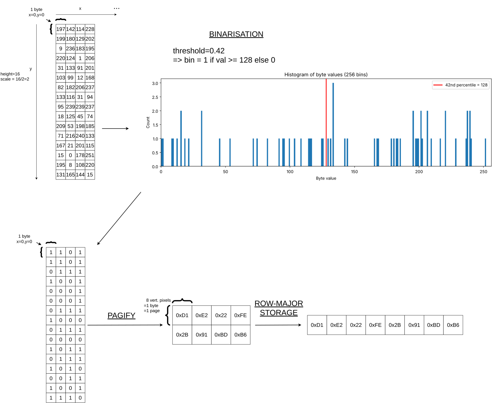

# font_rasterizer

A simple C++ program that rasterizes all printable ASCII characters in a chosen font (.ttf) and outputs a C header file for use in embedded software (i.e. microcontrollers).

The output is laid out in the page format used by monochrome display controllers such as the SSD1306, so glyphs can be sent to the display with no extra processing on the device.

## Building

This is a standalone project. Everything it needs (including [stb_truetype](https://github.com/nothings/stb)) is already in the repository, so there is nothing extra to install for a normal build.

```bash
sudo apt update
sudo apt install build-essential cmake
cmake -B build -DDEBUG=0
cmake --build build
```

### Debug build

Passing `-DDEBUG=1` also writes a `.png` preview of every rasterized glyph to the `vis` folder. This needs OpenCV 4 to be installed. With `-DDEBUG=0`, no previews are produced and OpenCV is not required.

```bash
sudo apt update
sudo apt install build-essential cmake libopencv-dev
mkdir vis
cmake -B build -DDEBUG=1
cmake --build build
```

The `vis` folder needs to exist in the directory you run the program from.

## Usage

```
./build/FontRasterizer <TTF file> [scale] [binaryThreshold]
```

| Argument | Description | Default |
| --- | --- | --- |
| `TTF file` | Path to the font you want to rasterize | required |
| `scale` | Integer >= 1. The glyph height will be `8 * scale` pixels | `2` |
| `binaryThreshold` | Value between 0 and 1 (exclusive) used to decide which pixels end up on or off | `0.6` |

For example, to generate a 16 pixel high font:

```bash
./build/font_rasterizer path/to/font.ttf 2 0.6
```

This writes `output.h` to the current directory, which you can copy straight into your firmware project.

## Output format



The diagram shows how each glyph goes from a grayscale bitmap to the final page layout.

* Every glyph is output with the same height, `8 * scale` pixels. `scale` therefore controls how many pages each glyph needs, how much storage the whole font takes up, and how large the characters are by default.
* Widths vary from glyph to glyph. They are stored in the widths array in the header.
* Glyphs are stored in ascending ASCII order, covering every visible character from 33 (`!`) to 126 (`~`).
* A macro is provided to convert an ASCII code into an index for the widths and offsets arrays.
* Each glyph is first binarised using a histogram method with a percentile threshold (the `binaryThreshold` argument). The binary image is then packed into pages, where each column of 8 vertical pixels becomes a single byte. Pages are stored in row-major order, so the first byte of each glyph holds the first vertical column of 8 pixels.

### Contents of `output.h`

You should replace FONTNAME with the name of the font, or remove it altogether if there is only one font in your project.

| Name | Description |
| --- | --- |
| `FONT_FONTNAME_NUM_PAGES` | Number of pages per glyph (equal to `scale`) |
| `FONT_FONTNAME_PIXEL_HEIGHT` | Glyph height in pixels |
| `FONT_FONTNAME_CIDX(i)` | Converts an ASCII code to an array index |
| `FONT_FONTNAME_WIDTHS` | Width of each glyph in pixels |
| `FONT_FONTNAME_OFFSETS` | Byte offset of each glyph inside the bitmap buffer |
| `FONT_FONTNAME_GBUF` | The packed bitmap data for all glyphs |

All arrays are stored in program memory (`PROGMEM`), so on AVR they must be read with the `pgm_read_*` functions.

## Using the header in your project

Include `output.h` and look up a character like this (AVR example):

```c
#include <stdint.h>
#include <avr/pgmspace.h>
#include "output.h"

uint8_t c = 'A';

// bitmap for character A specifically!
uint32_t idx = FONT_FONTNAME_CIDX(c);
uint32_t off = pgm_read_dword(FONT_FONTNAME_OFFSETS + idx);
uint8_t w = pgm_read_byte(FONT_FONTNAME_WIDTHS + idx);
const uint8_t *glyph = FONT_FONTNAME_GBUF + off;

for (uint8_t page = 0; page < FONT_FONTNAME_NUM_PAGES; page++) {
    for (uint8_t column = 0; column < w; column++) {
        // x = column
        // y = page*8,page*8 + 1, ..., page*8 + 7

        // 8 bits of data, stack of 8 vertical pixels!
        const uint8_t pageData = pgm_read_byte(glyph + w * page + column); 
        const uint8_t topPixel = pageData & 1;  // LSB
        const uint8_t bottomPixel = (pageData & (1 << 7)) >> 7; // MSB 
    }
}
```

## Testing

A CI pipeline builds the program and checks its output against a golden file (`test/golden.txt`).

## Contributing

Contributions are welcome. Fork the repository, make your changes, and open a pull request.

## License

This project is licensed under the MIT License. See the [LICENSE](LICENSE) file in the project root for details.

## Third-Party Notices

This project uses [stb_truetype](https://github.com/nothings/stb), a single-header TrueType font parsing library by Sean Barrett.

The `stb_truetype` header is included in the `thirdparty` directory and is subject to its own copyright notice and license terms.

All third-party files included in the `thirdparty` directory remain the property of their respective copyright holders. Copyright and licensing terms for these files belong to their respective owners.

Third-party software is provided under the licenses accompanying the respective files. Please refer to the individual files for their applicable copyright notices and license terms.